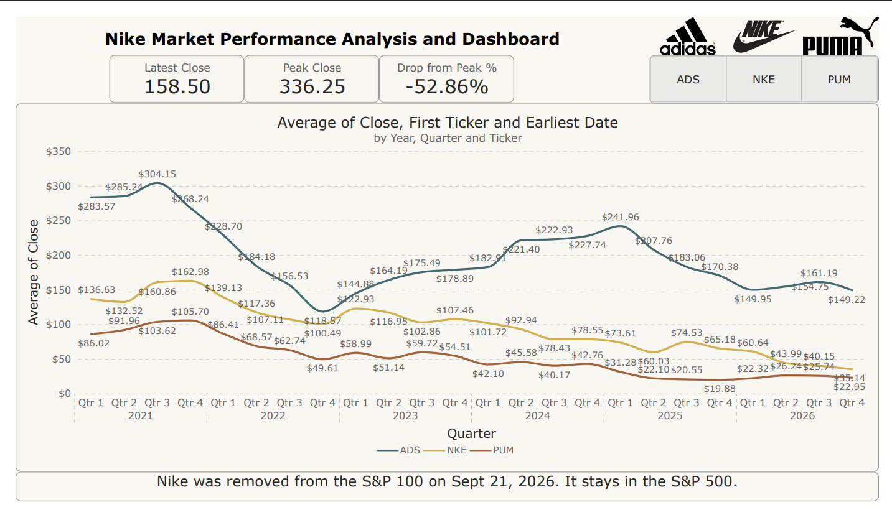
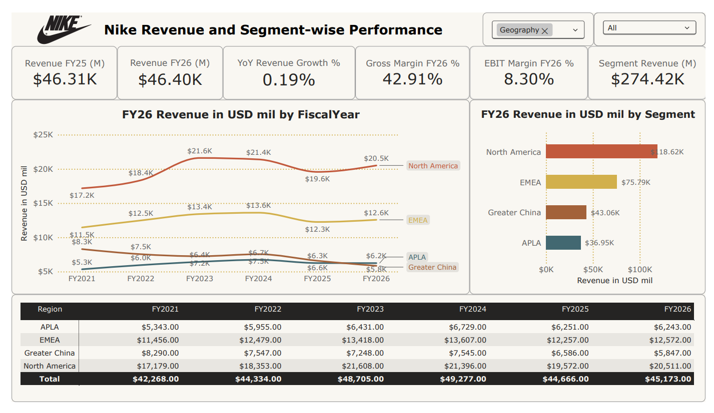
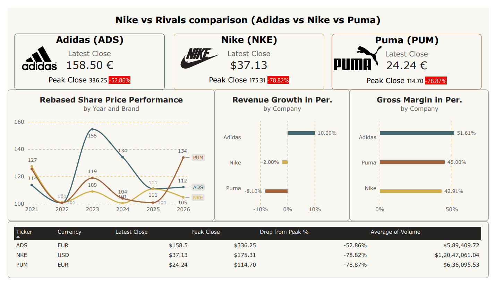

# Nike Market Performance Analysis

A three-page Power BI dashboard that tracks Nike's share price, revenue and profitability from FY2021 to FY2026 and benchmarks the company against Adidas and Puma.


---

## Table of Contents

1. [Problem Statement](#1-problem-statement)
2. [Dataset Description](#2-dataset-description)
3. [Power BI Implementation](#3-power-bi-implementation)
4. [Analysis Used](#4-analysis-used)
5. [Key Findings](#5-key-findings)
6. [Data Notes and Limitations](#6-data-notes-and-limitations)
7. [Dashboard Preview](#7-dashboard-preview)
<!-- 8. [Repository Structure](#8-repository-structure) -->
8. [How to Open the Report](#8-how-to-open-the-report)

---

## 1. Problem Statement

Nike's share price is 78.8% below its November 2021 peak. Revenue has not recovered either: FY2026 revenue of $46.4B is 9.7% below the FY2024 high of $51.4B, and EBIT margin has fallen from 15.5% in FY2021 to 8.3% in FY2026.

This project asks whether that weakness is specific to Nike or shared across the sector, and where inside Nike's business it shows up.

Questions the dashboard answers:

1. How has Nike's share price moved since 2021 compared with Adidas and Puma?
2. How far below its peak is each of the three stocks today?
3. Is Nike's revenue decline spread across regions or concentrated in a few?
4. How have gross margin and EBIT margin changed between FY2021 and FY2026?
5. How does Nike compare with Adidas and Puma on revenue growth and gross margin?

The report is meant for analysts and stakeholders who want these answers without reading three sets of financial filings.

---

## 2. Dataset Description

### 2.1 Sources

| Source | Grain | Rows | Coverage | Used on |
|---|---|---|---|---|
| `Prices.csv` | One row per ticker per trading day | 19,735 | NKE from 19 Aug 1987; ADS and PUM from 2 Jan 2007; all to Oct 2026 | Pages 1 and 3 |
| `nke_us_d.csv`, `ads_de_d.csv`, `pum_de_d.csv` | One row per trading day | 9,864 / 4,850 / 5,021 | Raw price exports for each ticker, stacked into `Prices.csv` | Input to `Prices.csv` |
| `NikeRevenue.xlsx` | One row per fiscal year | 6 | FY2021 to FY2026 | Page 2 |
| `NikeRegions.xlsx` | One row per fiscal year per region or segment | 42 | FY2021 to FY2026, 7 lines per year | Page 2 |
| `Peers.xlsx` | One row per company | 3 | Latest full fiscal year for each company | Page 3 |

The three Excel workbooks were compiled from company filings:

- Nike Q4 combined schedules (FY2021 to FY2024) and combined tables (FY2025 and FY2026)
- adidas FY2025 Fact Sheet
- PUMA group results release (26 February 2026) and Annual Report 2025

Each workbook has a `Notes` sheet that records where every input came from.

### 2.2 Data dictionary

| File | Columns |
|---|---|
| `Prices.csv` | `Date`, `Ticker` (NKE, ADS, PUM), `Open`, `High`, `Low`, `Close`, `Volume`, `Currency` (USD or EUR) |
| `NikeRevenue.xlsx` | `FiscalYear`, `Revenue_USD_bn`, `Revenue_USD_m`, `Cost_of_Sales_USD_m`, `Gross_Profit_USD_m`, `Gross_Margin_Pct`, `Net_Income_USD_m`, `EBIT_USD_m`, `EBIT_Margin_Pct`, `Revenue_YoY_Pct`, `Revenue_YoY_CurrencyNeutral_Pct`, `Period_End` |
| `NikeRegions.xlsx` | `FiscalYear`, `Period_End`, `Region` (North America, EMEA, Greater China, APLA, Converse, Global Brand Divisions, Corporate), `Segment_Type` (Geography, Brand, Other), `Revenue_USD_m`, `Share_of_Total_Pct` |
| `Peers.xlsx` | `Company`, `Latest_Full_Year`, `Revenue_bn`, `Currency`, `Growth_Pct`, `Gross_Margin_Pct`, `Source_Note` |

### 2.3 Preparation and validation

- The three per-ticker price exports were stacked into one table. `Ticker` and `Currency` columns were added so one slicer can drive every price visual. No column in `Prices.csv` has missing values.
- Revenue figures are as originally reported in each year's unaudited Q4 earnings schedule, in USD millions.
- Percent columns are stored as percentage points (`42.9` means 42.9%).
- Revenue by geography, plus Converse, Global Brand Divisions and Corporate, adds up to reported total revenue in all six years. For FY2026: 45,173 + 1,174 + 49 + 2 = 46,398.
- Puma figures come from the group consolidated results. The parent company's German-GAAP statements (net sales EUR 662.8m) were deliberately not used.
- Peer growth rates are currency-neutral (Puma: currency-adjusted), so they are not distorted by exchange rates.

---

## 3. Power BI Implementation

### 3.1 Report structure

| Page | Title | Question it answers | Visuals |
|---|---|---|---|
| 1 | Nike Market Performance Analysis and Dashboard | How have the three share prices moved, and how far are they from their peaks? | Three KPI cards (Latest Close, Peak Close, Drop from Peak %), ticker slicer (ADS / NKE / PUM), line chart of average close by year, quarter and ticker, text note on index membership |
| 2 | Nike Revenue and Segment-wise Performance | Where is Nike's revenue and margin coming from, and which regions are shrinking? | Six KPI cards, Geography slicer and a second dropdown filter, line chart of revenue by region over FY2021 to FY2026, bar chart of revenue by segment, table of revenue by region and fiscal year with totals |
| 3 | Nike vs Rivals comparison | How does Nike rank against Adidas and Puma? | Three brand cards with peak-drop flags, rebased share price line chart, diverging bar chart of revenue growth, bar chart of gross margin, summary table by ticker |

### 3.2 Measures

| Measure | Page | Definition | Value shown |
|---|---|---|---|
| Latest Close | 1, 3 | Close on the most recent trading day for the selected ticker | ADS 158.50 EUR, NKE 37.13 USD, PUM 24.24 EUR |
| Peak Close | 1, 3 | Highest Close in the price history | 336.25 EUR, 175.31 USD, 114.70 EUR |
| Drop from Peak % | 1, 3 | Latest Close / Peak Close - 1 | -52.86%, -78.82%, -78.87% |
| Average of Volume | 3 | Mean daily volume per ticker | Table column |
| Revenue FY25 (M), Revenue FY26 (M) | 2 | Total NIKE, Inc. revenues, USD millions | 46,309 and 46,398 |
| YoY Revenue Growth % | 2 | FY2026 revenue / FY2025 revenue - 1 | 0.19% |
| Gross Margin FY26 % | 2 | Gross profit / revenue | 42.91% |
| EBIT Margin FY26 % | 2 | EBIT / revenue | 8.30% |
| Segment Revenue (M) | 2 | Revenue summed over the selected segment type and all fiscal years | 274,420 (four geographies, FY2021 to FY2026 combined) |
| Rebased share price | 3 | Average close by year expressed as an index (baseline 100) so EUR and USD tickers share one axis | Chart range 100 to 155 |
| Revenue growth, gross margin by company | 3 | Read from `Peers.xlsx` | See section 5 |

### 3.3 Design decisions

- **One question per page.** Market view, Nike internals, peer comparison. Each page can be read on its own.
- **Fixed brand colours.** On pages 1 and 3, Adidas is teal, Nike is gold and Puma is rust, so a colour always means the same company. Page 2 uses its own colours for regions.
- **Index instead of price for peers.** Adidas and Puma trade in EUR and Nike in USD at very different price levels. Raw prices cannot share an axis, so page 3 compares an indexed series.
- **Quarterly averages on page 1.** Averaging daily closes by quarter removes day-to-day noise and keeps six years readable on one chart.
- **Red flags for drawdowns.** The drop from peak is highlighted on the brand cards so the largest declines stand out first.
- **Diverging bars for growth.** Positive and negative growth sit on opposite sides of zero, which makes the Adidas versus Puma contrast visible immediately.
- **Interactive filters.** The ticker slicer on page 1 and the Geography filters on page 2 let the user isolate one company or one region without leaving the page.

### 3.4 Data model

The four sources sit at different grains: daily (`Prices`), annual (`NikeRevenue`), annual by region (`NikeRegions`) and one row per company (`Peers`). Each page is driven by the table that matches its grain. Page 1 uses `Prices`, page 2 uses `NikeRevenue` and `NikeRegions`, and page 3 combines `Prices` and `Peers`.

---

## 4. Analysis Used

| Technique | How it is applied | Output |
|---|---|---|
| Descriptive statistics | Latest, peak and average volume per ticker | KPI cards and summary table |
| Drawdown analysis | (Latest close - peak close) / peak close | Drop from Peak % |
| Time aggregation | Daily closes averaged by quarter, 2021 to 2026 | Page 1 trend chart |
| Indexing (rebasing) | Share prices converted to a common baseline of 100 | Cross-currency comparison on page 3 |
| Growth analysis | Year-over-year revenue growth, reported and currency-neutral | YoY card, peer growth bars |
| Profitability analysis | Gross margin, EBIT margin and net income, FY2021 to FY2026 | Margin cards and trend |
| Revenue mix analysis | Revenue and share of total by region, cumulative and by year | Regional line, bar and table |
| Peer benchmarking | Nike, Adidas and Puma on growth and gross margin | Page 3 bar charts |
| Reconciliation checks | Segment revenue tied back to reported total revenue | Validation of the Excel inputs |

---

## 5. Key Findings

These are descriptive results. The dashboard shows what happened, not why.

### Share price and peers

| | Nike | Adidas | Puma |
|---|---|---|---|
| Latest close | $37.13 | EUR 158.50 | EUR 24.24 |
| Peak close | $175.31 | EUR 336.25 | EUR 114.70 |
| Drop from peak | -78.82% | -52.86% | -78.87% |
| Revenue growth, latest full year (currency-neutral) | -2.0% | +10.0% | -8.1% |
| Gross margin, latest full year | 42.91% | 51.61% | 45.00% |

- All three stocks peaked in the second half of 2021: Adidas in August, Nike and Puma in November.
- Nike and Puma are both about 79% below their peaks. Adidas is about 53% below.
- Adidas is the only one of the three with positive growth, and it also has the highest gross margin. Nike has the lowest.
- Page 1 also records that Nike was removed from the S&P 100 on 21 September 2026 and remains in the S&P 500.

### Nike revenue and profitability

- Revenue rose from $44.5B in FY2021 to a peak of $51.4B in FY2024, fell 9.8% to $46.3B in FY2025, and was flat in FY2026 at $46.4B (+0.19% reported, -2% currency-neutral).
- EBIT margin fell from 15.5% in FY2021 to 8.3% in FY2026. Gross margin moved less, from 44.8% to 42.9%, so most of the squeeze came from costs below gross profit.
- Net income fell 45.7%, from $5.7B in FY2021 to $3.1B in FY2026.

### Regional mix

| Region | FY2021 revenue ($M) | FY2026 revenue ($M) | Change | Share of total, FY2026 |
|---|---|---|---|---|
| North America | 17,179 | 20,511 | +19.4% | 44.2% |
| EMEA | 11,456 | 12,572 | +9.7% | 27.1% |
| Greater China | 8,290 | 5,847 | -29.5% | 12.6% |
| APLA | 5,343 | 6,243 | +16.8% | 13.5% |

- The decline is concentrated rather than broad. Greater China lost 29.5% of its revenue and its share of the total dropped from 18.6% to 12.6%.
- North America is now 44.2% of revenue, up from 38.6% in FY2021.
- Converse revenue fell from $2.2B to $1.2B (-46.8%) over the same period.

---

## 6. Data Notes and Limitations

- **Prices are not converted to a common currency.** Adidas and Puma are in EUR and Nike is in USD. The dashboard compares drawdowns and indexed performance, not absolute prices.
- **Fiscal calendars differ.** Nike's fiscal year ends 31 May (FY2026 is June 2025 to May 2026). Adidas and Puma report on a calendar year. The peer comparison uses the latest full year for each company, so the periods are about five months apart.
- **Geography totals exclude some revenue.** The regional table on page 2 sums the four geographies only (FY2026: $45,173M). Total NIKE, Inc. revenue also includes Converse, Global Brand Divisions and Corporate ($46,398M).
- **The segment bar chart and the Segment Revenue card are cumulative.** They add up all six fiscal years, not a single year.
- **FY2026 profit includes a one-off tariff item.** The Q4 FY2026 filing records a $965M benefit in North America and $21M at Converse for the expected recovery of IEEPA tariffs paid, which largely offsets the tariff cost recognised earlier in the year. Margins for FY2026 should be read with that in mind.
- **Peer coverage is three companies.** Findings about "the sector" rest on Adidas and Puma only.
- **Price snapshot date.** The dashboard cards reflect closes up to 16 October 2026. Refreshing the report after loading a later `Prices.csv` will change the Latest Close and Drop from Peak values.

---

## 7. Dashboard Preview

**Page 1: Market performance**



**Page 2: Revenue and segment performance**



**Page 3: Nike vs rivals**



---

<!--

## 8. Repository Structure

```
nike-market-performance-analysis/
├── data/
│   ├── Prices.csv
│   ├── nke_us_d.csv
│   ├── ads_de_d.csv
│   ├── pum_de_d.csv
│   ├── NikeRevenue.xlsx
│   ├── NikeRegions.xlsx
│   └── Peers.xlsx
├── sources/
│   ├── Nike FY21 to FY26 Q4 combined schedules (PDF)
│   └── Adidas-FY_2025_Fact_Sheet_EN.pdf
├── images/
│   ├── page1_market_performance.png
│   ├── page2_revenue_segments.png
│   └── page3_nike_vs_rivals.png
├── report/
│   └── Power BI report (.pbix)
└── README.md
```

--- -->

## 8. How to Open the Report

1. Clone the repository.
2. Open the `.pbix` file in Power BI Desktop.
3. If Power BI cannot find the data, go to **Transform data > Data source settings** and point each source at the matching file in the `data/` folder.
4. For the Excel files, choose the data sheet (`NikeRevenue`, `NikeRegions`, `Peers`), not the `Notes` sheet.
5. Select **Refresh** to reload the data.

**Tools:** Power BI Desktop, DAX, Power Query, Excel.